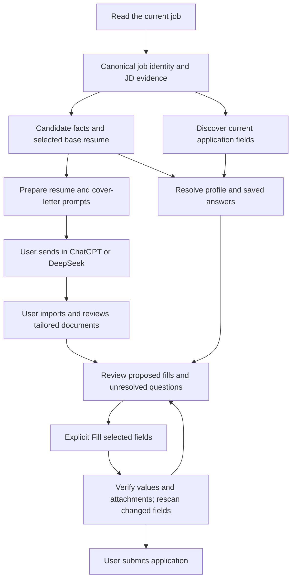

# Jobright, Simplify, and Job Wizard workflow review

Reviewed **2026-11-10** against the supplied local extension builds. This is a static implementation review, not a live account or ATS compatibility test.

## Main findings

1. **Job extraction and application-form extraction are different systems.** A job description describes the role; an application form supplies questions, controls, options, requiredness, and conditional steps. These references maintain both.
2. **The useful reference differs by layer:** Simplify for configurable ATS detection/extraction and profile mappings; Jobright for site-specific execution and document selection; Job Wizard for job/form ownership, asynchronous answer handling, and verified commits.
3. **Tailoring is substantially service-backed.** Jobright retrieves tailored documents and opens its website for tailoring. Simplify opens its web builder. Job Wizard calls analysis, generation, and PDF-draft endpoints. The packages do not expose complete server prompts, models, or generation algorithms.
4. **Reliable autofill is a collection–resolution–write–verification loop.** It is not a single scan followed by assigning `.value` to every input.
5. **Our existing job reader is a useful starting point.** The missing pieces are a durable canonical job identity, stronger JD-source ownership, a cover-letter/document workflow, a separate application-answer profile, and an independently designed autofill engine.

The review does not enable automation or change the current manual sending behavior.

## Snapshot and evidence

| Supplied build | Manifest version | Important entry points |
| --- | --- | --- |
| [Jobright](../baseline/jobright/manifest.json) | 1.26.1 | `helper-app.41ea2652.js`, `static/background/index.js`, `field-discovery.d71b3ac3.js`, ATS submission scripts |
| [Simplify](../baseline/Simplify/manifest.json) | 3.1.14 | `contentScriptMain.js`, `background.js`, `pageScript.js`, `remoteConfig.json` |
| [Job Wizard](../baseline/jobwizard/manifest.json) | 1.1.52 | `js/bundle.js`, `js/background.js`, job/source/form/choice controller modules |

[baseline-workflows-evidence.json](baseline-workflows-evidence.json) records **31 evidence anchors**, source paths, source hashes, line numbers, UTF-16 offsets, byte offsets, and bounded excerpts. Evidence IDs below refer to that index. Hashes identify the actual supplied files; manifest versions alone do not establish that a directory is an unchanged vendor release.

These are compiled packages, with readable modules and additional controller/debug code in the supplied snapshots. Some behavior is inlined into large bundles. Names such as `fullAIAutofillEnabled`, `Insight v2`, or a function called `submitApplication` establish available client paths, not proof that those paths are enabled, reachable for every account, or successful on a live site. Vendor API requests were inspected but not executed. The additional `SpeedyApply` directory was noticed but is outside the three requested references.

## 1. Fetching job data

### Jobright: identify the ATS, import/resolve the job, then bind it to documents

The helper's crawler factory selects concrete implementations for Greenhouse, Lever, Ashby, Workday, iCIMS, Oracle Cloud, and many other sites. Site selection is separate from the form filler and document stores. The background has separate job-detail lookup, URL lookup, external-job storage, and job-import endpoints. Thus “fetch job data” can mean reading the active page, resolving an external URL to a Jobright job ID, or retrieving a previously imported job. **J01–J03**.

Important identity mechanisms include `jr_id`, ATS-specific URL handling, trusted referrer/nested-URL propagation, and the current tab's job context. `buildJobrightTailorUrl` constructs `/jobs/info/<jobId>?plugin_tailor=1`, with an optional source resume ID. This links an ATS application to the same job used by tailoring rather than using the current page title as an identifier. **J07**.

**Lesson:** keep the original source URL, canonical ATS identity, and internal record ID as separate fields. Carry those identities through application redirects, document selection, and answers. Do not confuse an ATS company's name with the hiring employer.

### Simplify: configuration-driven identity and extraction, with structured-data fallback

The supplied `remoteConfig.json` contains **58 entries under `ATS`**, of which **54 are object configurations with a `urls` array**. These counts describe the configuration shape, not independently verified site coverage. There are also four board configurations—Handshake, Indeed, LinkedIn, and WelcomeToTheJungle—and 58 `ResumeScores` configurations.

ATS configurations describe URL patterns, embedded forms, excluded regions, canonical `trackedObj` extractors, application containers, input selectors, tracked-input selectors, fill methods, and submission/success selectors. Job selectors also live under `ResumeScores`; the name does not mean those entries are only used for scoring.

The `FO` collector in `contentScriptMain.js`:

1. Resolves a `trackedObj` using ordered URL/DOM extractor rules.
2. Reads configured title, description, location, and employer paths.
3. Uses additional field extractors when those values are missing.
4. Reads JobPosting JSON-LD, including description, qualifications, responsibilities, hiring organization, location, and base salary.
5. Keeps DOM-extracted and script-extracted information separately while assembling job information, with content/identity caches to avoid attaching reused content to a different posting. **S01**.

For example, the Workday score/extraction configuration identifies `jobPostingHeader`, `jobPostingDescription`, and location metadata with XPath rules. Greenhouse configurations distinguish direct boards, embedded application forms, and confirmation/excluded pages. The remote config also defines dependencies between profile fields and related controls, such as education and graduation information.

**Lesson:** use a declarative adapter catalog with explicit identity rules, source priority, and exclusions. Adopt individual verified selector facts into our own bounded adapters rather than importing a 38 MB configuration or depending on Simplify's remote configuration service.

### Job Wizard: owner-bound JD evidence, including embedded applications

The supplied build has a stronger source-ownership model than a generic `body.innerText` scraper:

- `jobIdentity.js` resolves canonical ATS/job identities and exposes versioned public references, generations, and JD fingerprints. It excludes credentials and session-like query parameters from identity handling. **W02**.
- `jobContextController.js` distinguishes entering, switching, and leaving jobs; it tracks JD ownership, readiness, revisions, and whether a request already claimed a context.
- `jdSource.js` supports a tightly validated Greenhouse embed path. It checks the exact host/path and `for`/`token` identity, requires a specific visible JD region, excludes form/profile/resume content, and bounds collection. Its cross-frame resolver checks frame identity, navigation epoch, browser-reported frame/document IDs, and source freshness before accepting a snapshot. **W01**.
- The main bundle also contains platform/generic JD candidate collection, content-region scoring, manual-input provenance, and transport/cache ownership checks. A manual JD is treated differently from extracted page text.

The specific Greenhouse collector requires at least 200 words and caps text at 30,000 characters; those are that collector's guards, not universal requirements for every job page.

**Lesson:** distinguish role text from the applicant's own answers or resume. Bind JD text to the current job and document, and cancel or reject it after navigation. A short or missing description should remain an explicit extraction limitation, not silently become the entire application page.

## 2. Tailoring resumes

| Build | Visible client flow | What the package does not establish |
| --- | --- | --- |
| Jobright | Select a base resume; open the job-specific tailoring page; retrieve job/agent-tailored history; select the resulting document; download it for upload | The complete resume generation prompt, ranking policy, model, or backend implementation |
| Simplify | Collect the job identity; open `/builder` with tab ID, `trackedObj`, optional source resume ID, and UI options; retrieve/select resumes and score keyword coverage | The website builder's full rewriting algorithm or server-side generation prompts |
| Job Wizard | Build JD/resume analysis context; stream requirements, evidence, verdicts, and actions; choose improvements; request a PDF draft using the selected actions and analysis | The underlying model prompts, actual server fact checking, and full PDF generation code |

### Details worth retaining

**Jobright:** `/swan/resume-tailor/history?jobId=...`, agent resume endpoints, and `/api/resume-tailor/download` separate existing tailored content from download/rendering. The selected document is kept distinct from the resume collection and current job. The helper also has resume-to-autofill synchronization with current-context and revision checks; this means an uploaded document and an application's profile answers can be related but are not inherently the same object. **J07, J08, J10**.

**Simplify:** the builder handoff is explicit in the `v` helper. It passes identifiers and UI options rather than implementing the entire builder inside the content script. Keyword scoring uses `/v3/resume/score` with high- and low-priority keywords. A keyword match percentage is not proof of factual correctness or real hiring-system acceptance. **S02, S05**.

**Job Wizard:** `buildInsightV2RequestData` builds the job context and selected resume reference. `/insight_v2/analyze` streams events including `requirements_found`, `evidence_checked`, `ats_verdict`, `action_item`, and `run_completed`. `buildInsightV2PdfDraftPayload` packages the analysis and selected improvements; `/insight_v2/resume_draft_pdf` returns a downloadable draft with source metadata such as `resume_base_source`, `draft_source`, and `jd_source`. These calls are implemented client-side; the corresponding server is not included. **W03, W04, W12**.

**Recommendation:** keep candidate facts immutable; generate tailored wording and an explicit change list against those facts. Adopt Job Wizard's selected-improvements/review idea without treating vendor match scores as validation. Our own ChatGPT/DeepSeek workflow can use this design with manual prompt copy/send and explicit result import; it does not require their APIs or renewed automatic sending.

## 3. Generating and using cover letters

### Jobright

The background exposes `/swan/autofill/cover-letter` for generation. Its client wrapper requires a job ID and user prompt, checks the returned job ID against the requested job, and rejects a response lacking a non-empty document ID or Markdown. Other paths retrieve existing job/agent letters and download files. The helper also opens `/jobs/info/<jobId>?plugin_cover_letter=1` for its website flow. **J09**, plus the helper's `openTailorTab` cover-letter action.

**Useful distinction:** “existing job letter,” “generate a new letter,” “edit a letter,” and “upload a letter” are separate operations. The client validates document/job association before treating a generation result as usable.

### Simplify

The background builds a cover-letter request from `tracked_obj`, job title, description, employer, and the user's prompt. It supports both plain generation at `/v2/candidate/me/copilot/cover-letter` and template-backed creation/update through candidate cover-letter endpoints. Template results have saved IDs/names and HTML content. **S04, S08**.

The content script distinguishes an opener, a text field, and a file upload. For text, it writes generated text into the relevant question. For files, it requests a PDF, creates a `File`, and fills the correct upload control. A stored HTML letter is not itself a PDF attachment. **S06**, and the `cover_letter_generated` field path.

### Job Wizard

The cover-letter controls send `generate_inf` with `method: "cover_letter"`, the current job URL, `web_content`, selected `resume_id`, user instructions, and optionally the existing text for improvement. Feature-owner checks prevent an old result from being attached to a different job after navigation. `/cover_letter/export` is a separate file-export operation. **W05**.

**Recommendation:** store a cover letter as a job/candidate-bound document alongside the resume, with its own ID, version, text, source chat, and optional file artifact. Do not make it an untracked text blob in the form filler. Keep text insertion and file attachment as distinct reviewed actions.

## 4. Autofill mechanics

### Jobright: site-specific execution plus backend answers

`BaseFiller` supplies task queues, cancellation checkpoints, field handlers, requiredness/progress tracking, answer requests, conditional-question handling, resume upload, and submission tracking. Concrete fillers implement site-specific extraction and writing. The Lever implementation separately handles text, location autocomplete, selects, checkboxes, radio groups, cover letters, and resume upload. It also has single-checkbox auto-check behavior; that behavior is not a policy we should copy automatically. **J01, J06, J11**.

The backend request paths include `/swan/autofill/fill`, `/fill-v2`, and `/fill-v2-stream`. Requests can include field information, page URL/HTML/tree, selected resume/tailoring identifiers, and a site/series token. Streaming responses carry indexed answers and profile information. The background validates SSE event shapes and handles cancellation, timeout, billing/limit failures, and completion. **J04**.

The separate field-discovery module first collects bounded DOM evidence and resolves recognizable fields locally. It can ask a service to classify unresolved fields using a snapshot ID and evidence references. It rejects ambiguous form roots and stale snapshots. Discovery/classification is distinct from supplying personal answers or writing a value into the page. **J05**.

### Simplify: normalized profile mappings first, question resolution when needed

Simplify normalizes candidate/profile/resume data into application-oriented keys, including file references. It tracks existing values and local edits, and supports saved answers. Its config maps site controls to those keys and supplies framework-specific filling methods.

For unresolved questions, its unified request builder distinguishes `text_input`, `select`, and `open_ended` requests. It sends question/section/form context, job information, profile hints, and available options. Responses can be `answer`, `needs_input`, `needs_premium`, or `unanswerable`, with provenance. The background batches requests in groups of 20 and retries limited transient failures. **S03**.

Writes use event sequences and framework-aware handling; file upload reconstructs a `File` from retrieved bytes and assigns it using `DataTransfer`. Custom choices, validation, remounted controls, and user edits require more than assigning `.value`. Some observed heuristic defaults—such as inferred graduation-date fallbacks—should not be adopted as candidate facts. **S06, S07**, and the content script's `inputValueSource` handling.

### Job Wizard: field ownership, scoped writes, and post-write proof

The supplied build decomposes this further:

- `formCollectionLifecycle.js` captures application and inventory epochs, structural signatures, and revisions; stale or remounted controls require collection/rebinding before committing. **W07**.
- `choiceOwnershipResolver.js` uses fieldsets, legends, ARIA groups, headings, labels, help text, and bounded ancestor/geometry analysis to associate choices with their actual question. A nearby Yes/No pair is not automatically owned by the nearest text node.
- `autofillBatchQueue.js` fingerprints question IDs, types, titles, options, and choice contracts; it prefetches eligible non-file answers and consumes only matching/current results.
- The `uinf` flow sends `question_info` and application context to the backend and maps returned answers back to stable answer IDs. **W06**.
- `typeaheadFill.js` treats typing, finding an option, choosing it, and proving the committed selection as separate stages. It requires current-owner checks and stable DOM readback, with explicit failure reasons. **W08**.
- `workdayNativeTransactions.js` observes Workday-side asynchronous update transactions rather than declaring success when text merely appears in a DOM property.
- `iframeWriteScope.js` binds writes to owner, run generation, attempt, expiry, concrete controls/documents, and manual-edit revisions. It revokes stale scopes on interaction, remount, or cancellation. **W09**.
- `applicationSubmitAuthority.js` separates reviewed autofill from submission. Its authorization is scoped to account, job, application, and run, and is consumed once; it does not imply the default runtime automatically submits everything. **W10**.
- `patternCacheManager.js` stores per-domain discovered patterns and updates success rates/usage. This is learned selector evidence, not permission to guess an applicant answer. **W11**.

**Recommendation:** use these ownership and verification concepts for an independent autofill design. Do not copy the broadest “fill everything” or submission behavior into the current manual workflow.

## 5. Proposed design for this repository

This separates three data models that the references show should not be conflated:

| Model | Minimum useful contents |
| --- | --- |
| Job context | ATS/tenant/job key, source and canonical URLs, title/employer, JD text/source/fingerprint, tab/frame/document identity, generation |
| Candidate/documents | Verified profile facts, explicit application answers, selected base-resume ID, tailored-resume and cover-letter versions, generation/source references, reviewed export files |
| Application field | Application owner, stable field ID, question/section, control type, requiredness, options/option IDs, existing value, manual revision, answer source, write result |

The existing [job reader](../src/job-page-evidence.mjs), [adapter table](../src/job-site-adapters.mjs), and [extraction core](../src/job-extraction-core.mjs) already cover structured data, platform selectors, generic-region ranking, bounded collection, and same-origin accessible frames. Preserve those strengths.

Current [job metadata provenance](../src/job-metadata.mjs) covers company and role; extending ownership/provenance to the full JD would be a concrete improvement. Company/URL duplicate checking is useful but does not replace canonical job identity across job-detail and application URLs.

The current [candidate schema and resume validation](../src/resume-data.mjs) preserve fixed profile facts, but do not define a full application-answer profile. Work authorization, compensation preferences, availability, and sensitive or consent-related answers need explicit user data/policy rather than inference from resume prose.

The current [manual prompt flow](../src/manual-prompt.mjs) and [manual queue policy](../src/queue-mode.mjs) should remain the default. There is no implemented general ATS autofill pipeline, dedicated cover-letter workflow, or connected PDF/DOCX exporter in the current UI. Reference study does not make those capabilities available automatically.

### Suggested implementation order

1. **Strengthen job context:** canonical ATS IDs, full JD provenance/fingerprints, application URL handoff, and narrowly scoped cross-origin Greenhouse evidence with browser-confirmed document ownership.
2. **Add resume + cover-letter review:** selected base resume, immutable input snapshot, proposed changes, separate saved documents, manual provider prompts/result import, then PDF/DOCX export.
3. **Build read-only form discovery:** collect labels/types/requiredness/options and display a fill preview without changing the page. Start with Greenhouse and Lever; add Ashby and Workday with dedicated fixtures.
4. **Add explicit, verified writes:** fill selected fields, preserve existing/manual values, select actual dropdown options, verify persisted values and attachments, and rescan conditional/repeated sections.
5. **Add optional learned mappings:** store successful site/question mappings with versioning and failure feedback. Keep answer memory separate from selector memory. Leave application submission manual.

Do not import vendor backend endpoints, account/session handling, remote code, or all-site permission sets as prerequisites. The reusable assets here are the contracts and workflow patterns; implementation should fit our own storage, page-access, and manual interaction model.

## Validation boundaries

- Reviewed the supplied source bytes and pinned the principal evidence files with SHA-256.
- Traced browser entry points, extraction/configuration paths, request payload construction, document handoffs, and representative write/verification controllers.
- Confirmed the referenced evidence markers exist in the supplied packages.
- Did not authenticate to vendor services, generate documents through those services, fill a real application, submit an application, or claim comparative extraction/ATS success rates.
- Did not alter runtime source or install/load any of these three baseline extensions during this review.

The first implementation work should therefore include realistic fixtures for listing/detail/application transitions, embedded jobs, multiple matching schemas, remounted inputs, asynchronous dropdown options, repeated employment/education blocks, text vs file cover letters, upload readback, and user edits arriving while answers are in flight.
