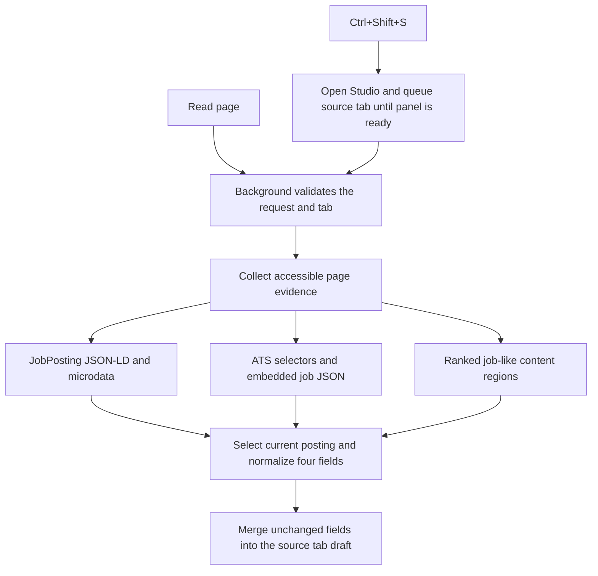

# Job extraction review and implementation

Reviewed on 2026-11-08. This work connects **Read page** and **Ctrl+Shift+S** to the four existing
Studio fields: Company, Job title, URL, and Job Description.

## Repository findings

Curated source files, READMEs, available licenses, repository trees, and immutable
commit references are stored in [baseline/job-extraction](../baseline/job-extraction/README.md).
The upstream projects were inspected as references; none is installed or imported
by the extension runtime.

| Reference | Pinned commit | Findings and implementation decision |
| --- | --- | --- |
| [JD Outreach Drafter](https://github.com/rakshathavasudev/jd-outreach-drafter) | `558779d45cd029b253fa16acbe39d63f50629cb1` | Its `extractor.js` combines JobPosting JSON-LD, named ATS/board selectors, and a vocabulary/density fallback. This is the closest match to the requested browser workflow. Our implementation adds current-posting selection, bounded collection, editable-field exclusion, and source-tab draft protection. MIT reference. |
| [ApplyAI](https://github.com/muhammad-saadd/applyai) | `d4a97b5643aa219592883a43b068fc18dff94678` | Separate Greenhouse, Lever, Ashby, and Workday content scripts expose useful description, title, and employer selectors. Those layout observations informed the adapter table. Application autofill, OpenAI calls, and form-field collection are outside this task. MIT reference. |
| [AppTracker](https://github.com/LucasFenaux/job-application-tracker) | `34cf2ef8b9af8be9aedecd0bde9a567047a36315` | The extension identifies job cards and supports learned selectors; the server scraper also uses Playwright, scrolling, pagination, and LLM fallbacks. Useful lessons are local field extraction and handling changing pages. The crawler, database, and model dependencies are unnecessary for reading the user's current job. Apache-2.0 reference. |
| [JobNavigator](https://github.com/vesaias/JobNavigator) | `623822529389d6919d86be07271e0ea94e20b514` | ATS-specific description readers, a generic fallback, LinkedIn's focused description region, and the changelog illustrate why descriptions and posting identity need separate handling. Its API-first server integrations are useful future extensions but do not fit this extension's existing temporary page access. We read accessible rendered/embedded data without adding a server or remote-site API permissions. MIT reference. |
| [HiringCafe+](https://github.com/rickyhires/hiringcafeextension) | `ae0f5d683dd3b8d96148920029ad44da5a298cac` | The content code reads `__NEXT_DATA__.props.pageProps.job`, processed job titles, company information, and requisition identifiers. Our collector understands relevant embedded field shapes. Its request interception, account write-back, tracking, and filters are not adopted. MIT reference. |
| [Hiring Cafe Scraper](https://github.com/HumbleIgnite/hiring-cafe-scraper) | Unavailable | The repository API returned HTTP 404, and the supplied README URL was unavailable. Its source and output-field claims could not be verified. The failure is recorded in `index.json`; no source was fabricated or substituted. |
| [Auto Apply / Jobright scraper](https://github.com/omkar3602/auto-apply) | `96248c602214fbe8dfd44f93182584d1e6a952d9` | `scrapers/description_fetch.py` contains ATS selector fallbacks. `scrapers/jobright.py` documents the embedded `jobright-helper-job-detail-info` JSON and separately stored summary, responsibilities, requirements, and benefits. Our collector can assemble these sections. Login automation, feed scraping, stealth settings, and application submission are excluded. No license was declared in the repository metadata; this remains reference-only. |

## Other supplied documentation

These are product/workflow references, not public extractor implementations.

| Source | Relevant finding |
| --- | --- |
| [Resumatica extension](https://www.resumatica.com/chrome-extension) | Describes explicit user-triggered page capture, common job-site handling, structured-markup fallback, and reviewing the captured fields. |
| [G-Track extension](https://www.jobtrack-ai.com/chrome-extension) | Describes saving role/company/description from job pages, per-page actions, and manual correction when a page lacks clear job information. |
| [Huntr job capture](https://help.huntr.co/en/articles/11479680-saving-jobs-to-huntr) | Documents employer-page and supported-board capture, with editable manual fallback and selection-assisted entry on unsupported sites. |
| [Teal bookmarking](https://help.tealhq.com/en/articles/9524956-teal-job-search-companion-bookmark-jobs) | Describes auto-populated job details followed by user review, and a manual form for unrecognized listings. |
| [Teal capture workflow](https://help.tealhq.com/en/articles/14435727-how-to-track-your-job-applications) | Emphasizes saving the full job description and retaining title, company, and source URL. |

## Implemented flow

`src/job-page-evidence.mjs` runs through `chrome.scripting.executeScript` in the
selected tab. It collects only relevant job fields, visible description regions,
and a small set of page metadata. It does not return entire hydration/session
objects. Editable controls, scripts, styles, navigation, and footers are excluded
from rendered-text collection. Open shadow roots and accessible same-origin
frames are inspected, with limits on depth, nodes, document count, and text size.

`src/job-extraction-core.mjs` chooses the posting using current URLs, selected job
IDs, and active headings. It handles graph/type-array metadata, organization
references, HTML descriptions, and duplicate embedded records. Ambiguous listing
metadata is not treated as the first job by default. Generic board branding is
not assumed to be the employer. Tracking parameters are removed while job-ID
parameters are retained.

`src/job-extraction-service.mjs` coordinates the read in the service worker. It
retries briefly for client-rendered content, detects navigation during a read,
and returns actionable errors for inaccessible or unsupported pages. It uses the
existing `activeTab` and `scripting` permissions; no new host permissions or API
keys are needed.

Studio keeps fields editable. A missing field does not erase an existing value.
Edits made after the read starts are preserved. If the user changes tabs, the
result is saved to the original tab's draft instead of filling the new tab.
Feedback uses the existing hover/accessibility channels without adding a
persistent status row. Reading works with tailoring on or off.

The `read-job-page` Chrome command uses Ctrl+Shift+S (Command+Shift+S on macOS).
It opens the native panel in the command's window and selects Review Job. A
one-shot request waits up to 30 seconds for panel startup, so a closed dock can
run the same Studio read handler as the button. Requests stay with their source
tab and window; a regular development tab cannot consume the dock's shortcut.

## Coverage and validation

The adapter table contains 24 initial ATS/board configurations. The common
structured-data, microdata, embedded-JSON, and generic-region paths also work
without a named adapter. Selector coverage is best-effort and needs maintenance
when a site changes its markup.

**Verified with Chrome fixtures:** JSON-LD graphs and multiple postings,
microdata, Greenhouse, Lever, Ashby, Workday, SmartRecruiters, Indeed, LinkedIn
detail panes, HiringCafe embedded data, Jobright sections, generic career pages,
open shadow roots, same-origin embeds, delayed rendering, partial fields,
non-job pages, blocked embeds, denied page access, and tab-switch races.

**Additional initial selector sets:** Workable, BambooHR, iCIMS, JazzHR,
Recruitee, Teamtailor, Personio, Oracle Recruiting, SuccessFactors, Jobvite,
Glassdoor, Wellfound, Handshake, ZipRecruiter, and Dice. These are not a claim
of live-site certification.

Validation: `npm test` passes 29 tests, and `npm run test:browser` checks the
existing workspace checks plus 20 extraction cases, Chrome's shortcut assignment,
and command delivery to open and freshly opened panels. CDP invokes the actual
registered worker handler through a native extension gesture; physical keyboard
delivery is not automated.
Browser tests use isolated,
local fixture documents, not the user's signed-in job-board accounts.

## Practical limits

- Use an individual job page, or a board detail pane with a clear selected job.
  An ambiguous list of jobs is not sufficient evidence to invent a selection.
- Click the extension icon on the job page to grant temporary page access, then
  click Read page, or press Ctrl+Shift+S to grant access and read in one action.
  Opening the dock on another origin does not grant access here. If another
  extension already uses the shortcut, assign it at `chrome://extensions/shortcuts`.
- Cross-origin embedded job pages require their own access. Open the embedded
  listing in its own tab when the outer company page cannot expose its contents.
- Closed shadow roots, inaccessible frames, login/challenge screens, PDFs, and
  descriptions not yet present in accessible page data can require manual entry.
- The extractor does not click Apply, submit forms, log in, intercept credentials,
  invoke an LLM, or fetch external ATS APIs. Imported job details remain drafts
  until the user chooses a subsequent Studio action.
